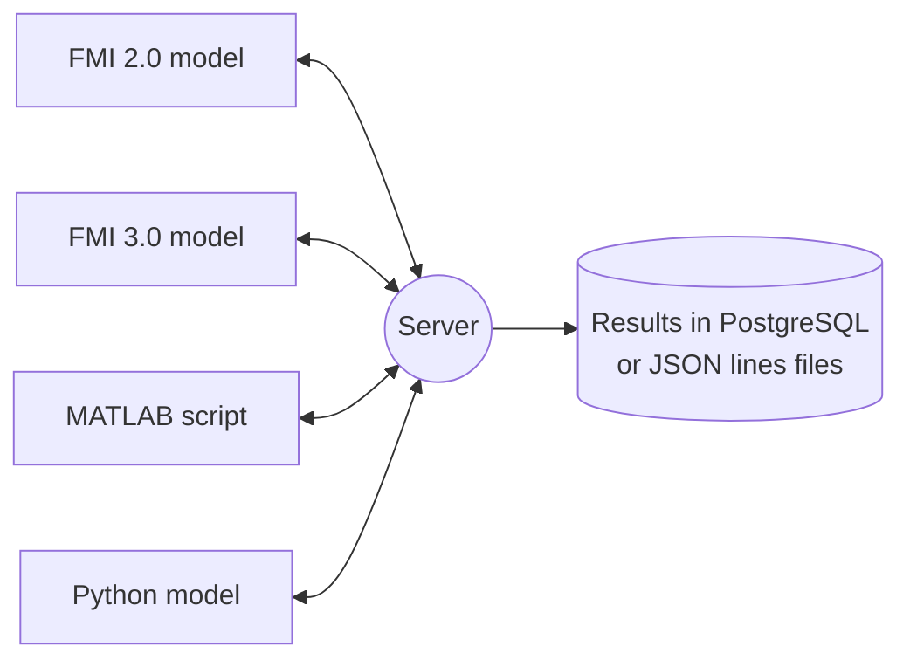

<h1>
<picture>
  <source media="(prefers-color-scheme: dark)" srcset="docs/static/img/readme/wordmark-dark.png">
  
</picture>
</h1>

A co-simulation framework for energy systems.

[](https://github.com/KIT-IAI-ESA/eCoSim/actions/workflows/tests.yml)
[](https://ecosim.easimov.com/docs)
[](LICENSE)
[](https://ecosim.easimov.com/docs/getting-started/installation)

eCoSim couples independent simulation models, such as a house, its heating and the weather, into one
co-simulation. A server owns the clock and the data flow. Each model runs in its own client, and for
every step the server sends each client its inputs, receives its outputs and passes them on to the
inputs they are connected to.



Clients exist for FMI 2.0 and FMI 3.0 models, for MATLAB scripts and for Python models. A Python model
runs in the client itself or is served over Pyro5. The server stores the results in PostgreSQL/TimescaleDB
or as JSON lines on disk. On one computer, the `ecosim` command writes a simulation from FMUs, checks it, runs
it and shows its results. For many simulations at once, `ecosim-hpc` runs the server and the clients on a
Dask cluster.

## Quick start

You need Python 3.12 or newer and [uv](https://docs.astral.sh/uv/). eCoSim is installed from source:

```shell
git clone https://github.com/KIT-IAI-ESA/ecosim.git
cd ecosim
```

The building example couples three FMI 2.0 models for 100 steps and writes the results as files, so
no database is needed. Check it, run it and look at its results:

```shell
cd simulation_examples
uv run ecosim check building
uv run ecosim run building --steps 100
uv run ecosim results building
```

The first `uv run` creates the environment, which takes a moment. `ecosim run` starts the server and
a client for each model, and writes the results and the logs into a new folder in `building/results`.
`ecosim results` shows the smallest, the mean and the largest value of each output. The
[quick start](https://ecosim.easimov.com/docs/getting-started/quick-start) explains each step, and
goes on with a parameter of the house and a simulation made from FMUs.

## What it looks like

A real run of the three commands, with the waits shortened.


## Documentation

The documentation is at [ecosim.easimov.com/docs](https://ecosim.easimov.com/docs).

- [Installation](https://ecosim.easimov.com/docs/getting-started/installation), the
  [quick start](https://ecosim.easimov.com/docs/getting-started/quick-start) and
  [your own models](https://ecosim.easimov.com/docs/getting-started/your-own-models)
- Guides: [Run a simulation](https://ecosim.easimov.com/docs/guides/run-a-simulation),
  [Read the results](https://ecosim.easimov.com/docs/guides/results),
  [Docker](https://ecosim.easimov.com/docs/guides/docker),
  [HPC cluster](https://ecosim.easimov.com/docs/guides/hpc-cluster),
  [MATLAB client](https://ecosim.easimov.com/docs/guides/matlab-client),
  [Pyro5 client](https://ecosim.easimov.com/docs/guides/pyro5-client),
  [Python client](https://ecosim.easimov.com/docs/guides/python-client)
- Reference: [command line](https://ecosim.easimov.com/docs/reference/command-line),
  [configuration files](https://ecosim.easimov.com/docs/reference/configuration-files)

## Contributing

Questions, bug reports and pull requests are welcome, see [Contributing](CONTRIBUTING.md). To work on
eCoSim itself, start with the [project setup](docs/content/development/project-setup.md). The
[architecture page](docs/content/development/architecture.md) lists the packages of this repository
and what each one does.

## Citing eCoSim

If you use eCoSim in your work, please cite it. The details are in [CITATION.cff](CITATION.cff), and
GitHub shows them under "Cite this repository" on the repository page.

## Licence

eCoSim is released under the [Apache License 2.0](LICENSE).

## Credits

<a href="https://www.iai.kit.edu/english/groups_4104.php"><picture><source media="(prefers-color-scheme: dark)" srcset="docs/static/img/readme/esa-dark.png"></picture></a>

eCoSim is a project of the [Energy System Analysis](https://www.iai.kit.edu/english/groups_4104.php)
research group at the [Institute for Automation and Applied Informatics (IAI)](https://www.iai.kit.edu/english/index.php)
of the [Karlsruhe Institute of Technology (KIT)](https://www.kit.edu/english/index.php). See also
[eASiMOV](https://easimov.cloud.iai.kit.edu) and the [Energy Lab](https://www.elab.kit.edu/english/index.php).
