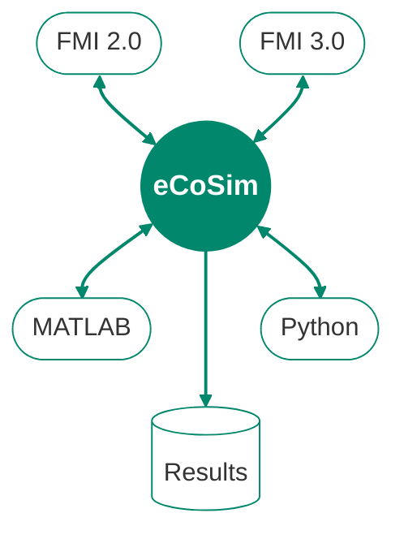

<div align="center">

<h1>

</h1>

A co-simulation framework for energy systems.

[](https://github.com/KIT-IAI-ESA/eCoSim/actions/workflows/tests.yml)
[](https://github.com/KIT-IAI-ESA/eCoSim/actions/workflows/windows-tests.yml)
[](https://github.com/KIT-IAI-ESA/eCoSim/actions/workflows/github-code-scanning/codeql)
[](https://ecosim.easimov.com/docs)
[](LICENSE)
[](https://ecosim.easimov.com/docs/getting-started/installation)
[](https://fmi-standard.org/)

</div>

eCoSim runs several simulation models together as one simulation, for example a house, its heating
and the weather. In every step it passes the outputs of each model on to the models that need them.



Your models can be FMUs (FMI 2.0 or 3.0), MATLAB scripts or Python code. The results go into files or
into PostgreSQL. To run many simulations on a cluster, see the
[HPC guide](https://ecosim.easimov.com/docs/guides/hpc-cluster).

## Quick start

You need Python 3.12 or newer and [uv](https://docs.astral.sh/uv/). eCoSim is installed from source:

```shell
git clone https://github.com/KIT-IAI-ESA/ecosim.git
cd ecosim
```

The building example runs three models for 100 steps. No database is needed:

```shell
cd examples
uv run ecosim check building
uv run ecosim run building --steps 100
uv run ecosim results building
```

The first run takes a moment to set up. The results and the logs end up in `building/results`. The
[quick start](https://ecosim.easimov.com/docs/getting-started/quick-start) explains each step and shows
how to use your own FMUs.

## What it looks like

A real run of the three commands, with the waits shortened.


## Documentation

The documentation is at [ecosim.easimov.com/docs](https://ecosim.easimov.com/docs).

## Contributing

Questions, bug reports and pull requests are welcome, see [Contributing](CONTRIBUTING.md).

## Citing eCoSim

If you use eCoSim in your work, please cite it. The details are in [CITATION.cff](CITATION.cff), and
GitHub shows them under "Cite this repository" on the repository page.

## Licence

eCoSim is released under the [Apache License 2.0](LICENSE).

## Credits

eCoSim is part of [eASiMOV](https://easimov.cloud.iai.kit.edu). It is a project of the
[Energy System Analysis](https://www.iai.kit.edu/english/groups_4104.php) research group at the
[Institute for Automation and Applied Informatics (IAI)](https://www.iai.kit.edu/english/index.php)
of the [Karlsruhe Institute of Technology (KIT)](https://www.kit.edu/english/index.php).
