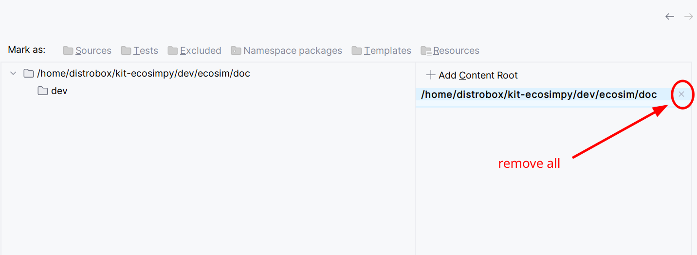

# Project setup

- [PyCharm](https://www.jetbrains.com/pycharm/) is the recommended IDE, though it is not required
- the following commands should be executed in the root directory of the project
- **either** run the `init_dev.py` script
    - `python init-dev.py`
- **or** do everything manually
    - install [uv](https://docs.astral.sh/uv/)
        - `pip install uv`
        - `uv` is a modern drop-in replacement for `pip`
    - create a Python virtual environment for each subproject and sync the project
        - `ecosim-common`, `ecosim-server`, `integration-tests`, `ecosim-client-*`
            - e.g. `cd ecosim-common && uv venv && uv sync`
    - install general dependencies
      - (within project root folder) `uv sync --extra dev`
    - install pre-commit hook
      - (within project root folder) `uv run pre-commit install`

## PyCharm

If you use PyCharm as the IDE you should do the following steps:

- install `mypy` plugin from Peter Szabo
    - after the installation reference the `mypy.ini` file as config file
        - Settings -> Tools -> MyPy -> Config file
          
- it should be enough to open the project root (`ecosim`) to load the project including the subprojects
    - **only** if this is not working and if you need to set everything up manually, follow the next steps
        - open the project root
        - remove all content root
            - Settings -> Project -> Project Structure -> remove the 'content root' on the right
              
        - open `ecosim-common` and select `Attach`
        - repeat for all subprojects
        - set up the interpreter for each subproject
            - Settings -> Project -> Python Interpreter -> [Subproject] -> Add exisiting
                - use `python` from the corresponding subproject's `.venv`
        - set up dependencies
            - Settings -> Project -> Project Dependencies -> [Subproject] -> select the needed projects
        - mark the root of each subproject as `Source`
