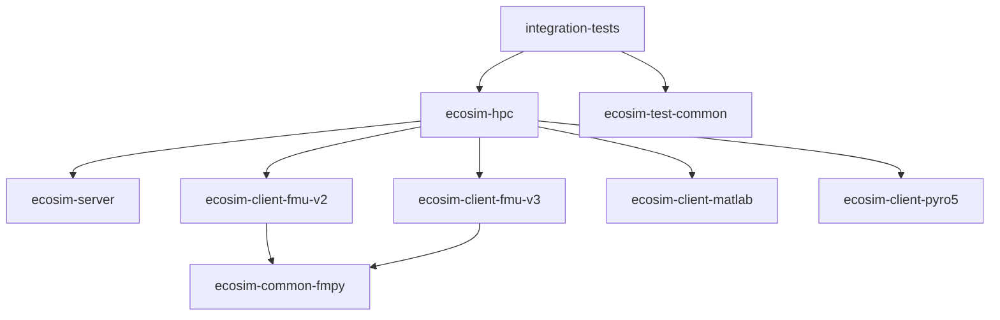

# Architecture

## Subprojects

Ten independent uv projects. Each has its own `pyproject.toml`, `uv.lock` and `.venv`, and
`dev/config.py:SUBPROJECTS` is the list the tooling iterates over.

| Subproject | Import package | Purpose |
| --- | --- | --- |
| `ecosim-common` | `ecosim_common` | Shared abstractions: config, communication, simulation primitives |
| `ecosim-common-fmpy` | `ecosim_common_fmpy` | Shared FMU/fmpy code for both FMU clients |
| `ecosim-server` | `ecosim_server` | The simulation server: state, repositories, measurements |
| `ecosim-client-fmu-v2` | `ecosim_client_fmu_v2` | Client for FMI 2.0 models |
| `ecosim-client-fmu-v3` | `ecosim_client_fmu_v3` | Client for FMI 3.0 models |
| `ecosim-client-matlab` | `ecosim_client_matlab` | Client for Matlab models |
| `ecosim-client-pyro5` | `ecosim_client_pyro5` | Client bridging via Pyro5 (e.g. pandapower) |
| `ecosim-hpc` | `ecosim_hpc` | HPC entry point and client manager |
| `ecosim-test-common` | `ecosim_test_common` | Shared fixtures, test data and FMU resources |
| `integration-tests` | `integration_tests` | Cross-package tests, needs the others installed |

## Dependency direction

An arrow points from a subproject to one it depends on. Every subproject also depends on
`ecosim-common`, which is left out of the diagram.



- `ecosim-common` depends on no other subproject; everything else depends on it
- only the two FMU clients use `ecosim-common-fmpy`
- `ecosim-hpc` depends on the server *and* on every client package, because it imports their
  classes directly: `hpc_main_process` constructs the `Server`, and `ClientManager` starts the
  clients as tasks on the dask cluster
- `integration-tests` depends on all of them, which is why it is excluded from `dev/run_tests.py`

Every internal dependency is pinned to the exact version (`ecosim-common==0.14.0`) and resolved
from the working tree through `[tool.uv.sources]` with `editable = true`. A version bump therefore
has to happen in every `pyproject.toml` at once.

## Module structure

### `ecosim_common`

| Package | Contains |
| --- | --- |
| `communication/channel` | `ESPChannel`, the transport abstraction, plus its message types |
| `communication/dask` | `DaskChannel` — transport over a dask cluster |
| `communication/socket` | `TCPSocket` — transport over a plain TCP socket |
| `communication/binary_message` | Framing: header, message assembly |
| `communication/data` | The payloads: meta data, interface settings, step requests |
| `config` | `AppConfig` (CLI parsing), `ConfigParser` (ini files), `DatabaseType`, interface ids |
| `client` | `Client` — the base class every client subproject specialises |
| `simulation` | Interface identity: `InterfaceID`, `ModelInterfaceID`, `SimulatorInterfaceID` |
| `tech` | Infrastructure without domain knowledge: logging, threading, json, datetime |

### `ecosim_server`

| Module | Contains |
| --- | --- |
| `main.py`, `server.py`, `server_state.py` | Entry point and the server lifecycle |
| `client/` | One `ClientConnection` per client, message buffer and subscriptions |
| `simulation/` | `SimulationExecutor`, the step loop, value history, restore |
| `simulation/state/` | `SimulationStateRepository` and its two implementations |
| `measurement/` | `MeasurementRepository` — the simulation results |
| `data/` | `Repositories` — the aggregate the rest of the server is given |
| `tech/db/` | SQLAlchemy and file backends, kept out of the domain code |
| `config/` | `CLIArguments`, `ServerConfig`, `SimulationConfig` |

### The clients

Every client subproject follows the same shape, so a new client is easy to place:

```
main.py               the console script
<name>_client.py      the Client subclass: talks to the server
<name>_simulator.py   drives the actual model
<name>_config.py      the model specific configuration
```

The FMU clients name the last one `fmu2_simulator_config.py` / `fmu3_simulator_config.py`; the
others use `matlab_config.py` and `pyro_config.py`.

## Communication

The server and the clients never speak a transport directly. They use `ESPChannel`, and
`ESPChannel.for_protocol()` picks the implementation from the configured
`CommunicationProtocol`:

| Protocol | In ini files | On the command line | Implementation |
| --- | --- | --- | --- |
| TCP socket | `TCP_SOCKET` | `tcp_socket` or `TCP_SOCKET` | `communication/socket/tcp_socket.py` |
| Dask | `DASK` | `dask` or `DASK` | `communication/dask/dask_channel.py` |

The ini files take the member name, because `ConfigParser.get_enum` looks the value up by name. The
command line goes through `CommunicationProtocol.of()`, which ignores the case.

`MessageType` is the protocol vocabulary. It is deliberately restricted to the values 0–255, so
that one byte carries it regardless of the transport underneath.

**The server initiates every exchange.** It sends a message and then waits for a reply of the
*same* `MessageType` — the type names the exchange, not a direction. `CorrelationId` matches a
reply to its request, which is what allows the steps to be sent from separate threads.

| Message | The server asks | The client replies |
| --- | --- | --- |
| `CLIENT_META_DATA_REQUEST` | who are you | its meta data |
| `INTERFACE_REQUEST` | which interfaces do you expose | its `ModelInterfaceIds`, which the server validates against the simulation config |
| `INTERFACE_SETTINGS` | here is your interface configuration | acknowledgement |
| `SIMULATION_SETUP` | here is the step size | acknowledgement |
| `SIMULATION_START` / `SIMULATION_STOP` | start / stop now | acknowledgement |
| `SIMULATION_STEP` | advance one step with these inputs | its outputs |
| `SIMULATION_STEP_BATCH` | advance several steps | the outputs of all of them |
| `PING` | are you alive | `PING` |

On the client side `Client._handle_message` dispatches over the same enum with an `assert_never`
default, so `mypy` rejects a new `MessageType` until the client handles it. The server has no such
single dispatch point: it sends and awaits each type where it needs it.

`SIMULATION_STEP_BATCH` exists for restoring aborted runs.

## Storage

The server writes through `Repositories`, an abstract aggregate: a `SimulationStateRepository`, a
`ServerTimeMeasurementRepository` and one `MeasurementRepository` per client.
`create_repositories()` chooses the implementation from the `type` in the `[database]` section of
the server ini:

| `DatabaseType` | Implementation | Needs |
| --- | --- | --- |
| `postgres` | `RepositoriesDB` | a PostgreSQL/TimescaleDB instance |
| `file` | `RepositoriesFileBased` | a writable directory, one JSON lines file per module |

Both are exercised end to end by `dev/docker/example/`. The domain code never sees the
difference; everything database specific lives under `tech/db/`.

## Entry points

Each deployable subproject declares a console script:

| Command | Module |
| --- | --- |
| `ecosim-server` | `ecosim_server.main:main` |
| `ecosim-client-fmu-v2` | `ecosim_client_fmu_v2.main:main` |
| `ecosim-client-fmu-v3` | `ecosim_client_fmu_v3.main:main` |
| `ecosim-client-matlab` | `ecosim_client_matlab.main:main` |
| `ecosim-client-pyro5` | `ecosim_client_pyro5.main:main` |

`ecosim-hpc` is started through `ecosim_hpc/main.py` instead — see the [HPC notes](tech/hpc-cheat-sheet.md).
