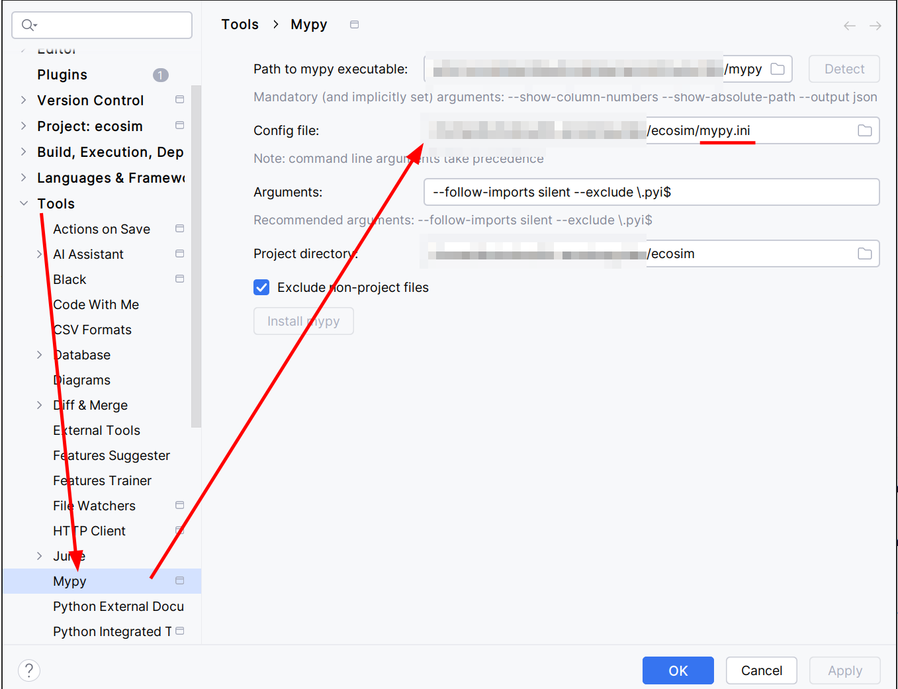
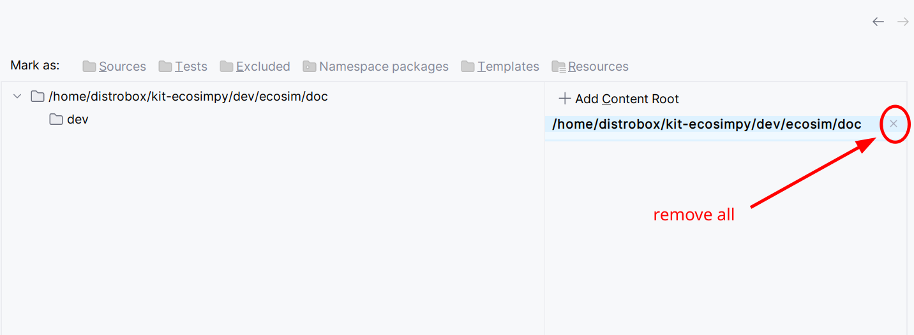
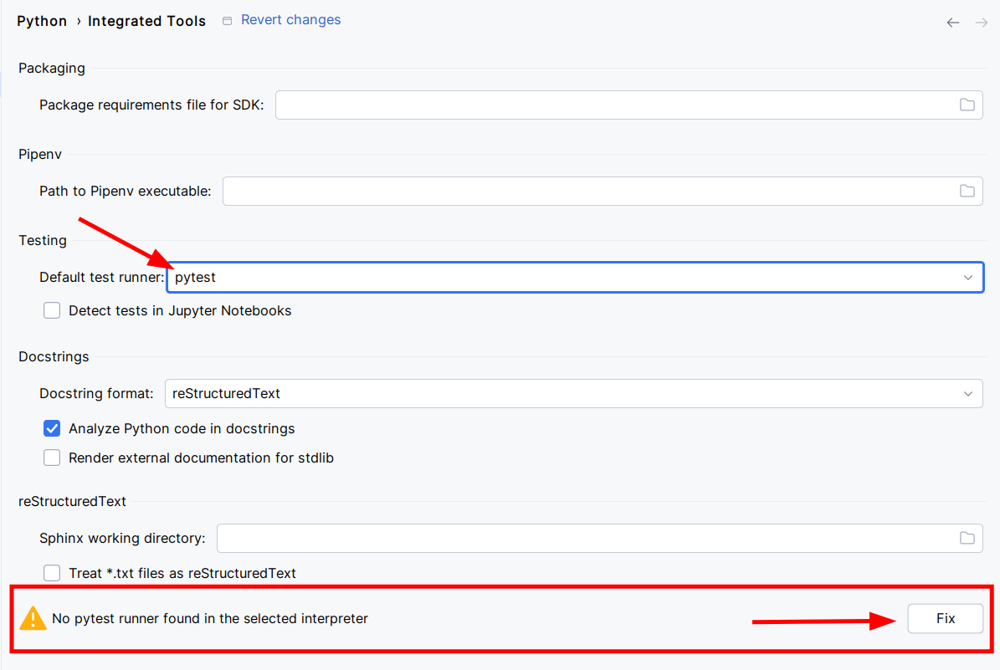
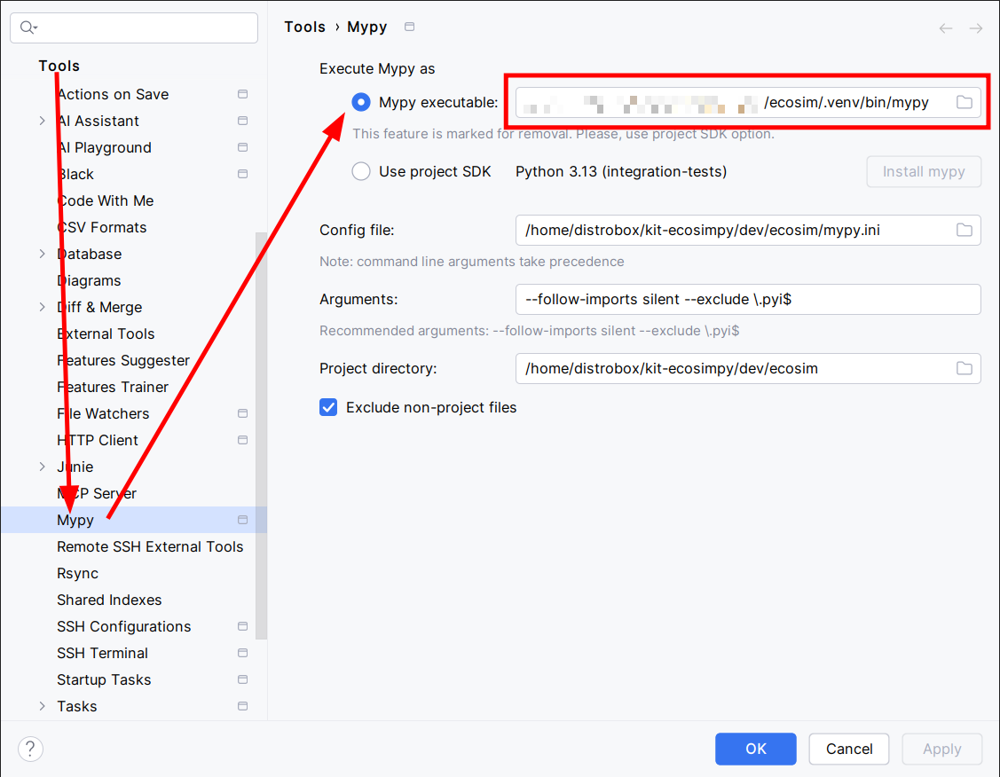

# Project setup

eCoSim is developed in this monorepo only. The packages on PyPI are for using eCoSim, not for
working on it, see [Releasing](releasing.md#development-happens-in-the-monorepo).

- [PyCharm](https://www.jetbrains.com/pycharm/) is the recommended IDE, though it is not required
- the following commands should be executed in the root directory of the project
- install [uv](https://docs.astral.sh/uv/) with the [official installer](https://docs.astral.sh/uv/getting-started/installation/)
    - `uv` is a modern drop-in replacement for `pip`
- **either** run the `init_dev.py` script
    - `python dev/init_dev.py`
      - *troubleshooting*
        - `'uv' is not on PATH`: install `uv` as described above and open a new terminal
- **or** do everything manually
    - sync every subproject listed in `SUBPROJECTS` in `dev/config.py`, which also creates its `.venv`
        - e.g. `cd ecosim-common && uv sync --extra dev`
        - `integration-tests` and `ecosim-test-common` have no `dev` extra: `uv sync`
        - `python dev/sync_projects.py` does this for all of them, including the project root
    - install general dependencies
      - (within project root folder) `uv sync --extra dev`
    - install pre-commit hook
      - (within project root folder) `uv run pre-commit install`

## PyCharm

If you use PyCharm as the IDE you should do the following steps:

- install `mypy` plugin from Peter Szabo
    - after the installation reference the `mypy.ini` file as config file
        - Settings -> Tools -> MyPy -> Config file
          
- it should be enough to open the project root (`ecosim`) to load the project including the subprojects
    - **only** if this is not working and if you need to set everything up manually, follow the next steps
        - open the project root
        - remove all content root
            - Settings -> Project -> Project Structure -> remove the 'content root' on the right
              
        - open `ecosim-common` and select `Attach`
        - repeat for all subprojects
        - set up the interpreter for each subproject
            - Settings -> Project -> Python Interpreter -> [Subproject] -> Add existing
                - use `python` from the corresponding subproject's `.venv`
        - set up dependencies
            - Settings -> Project -> Project Dependencies -> [Subproject] -> select the needed projects
        - mark the root of each subproject as `Source`

## Troubleshooting

### (PyCharm) Test configuration does not work

- with PyCharm, the test configuration should work after you synced the projects with `uv`
- if it does not, please check the settings of the integrated tools
  - Settings -> Python -> Integrated Tools
    - select `pytest` as default test runner
    - if you get a warning that `pytest runner` is not found, click the `Fix` button
    

## (PyCharm) Mypy shows import errors for subprojects

- e.g. if imports like `import ecosim_common.config` are marked as errors you probably have the wrong mypy executable selected
- Settings -> Tools -> Mypy -> Mypy executable
    - make sure the executable points to the `mypy` executable in the virtual environment of the project root
  
