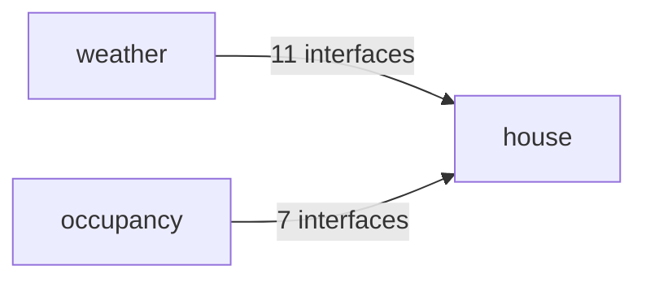

# Quick start

The building example couples three FMI 2.0 models. The weather and the occupancy feed the house,
which is simulated for 100 steps of 15 minutes each. The results are written as files, so no
database is needed.



You need [uv](https://docs.astral.sh/uv/). It also downloads Python 3.12 if it is missing.

## 1. Get the source

```shell
git clone https://github.com/mekkyz/ecosim-os.git
cd ecosim-os/simulation_examples/building/Executable
```

## 2. Start the server

```shell
uv run --project ../.. ecosim-server --server-config ../server/preferences.ini \
    --simulation-config ../server/simulation.json --steps 100 \
    --database-type file --database-directory results
```

The first run creates the environment, which takes a moment. The server then waits for the clients.

## 3. Start the clients

In a second terminal, in the same folder:

```shell
for module in house occupancy weather; do
    uv run --project ../.. ecosim-client-fmu-v2 --config-file "../Modules/$module/preferences.ini" --simulator-type fmu &
done
wait
```

The clients retry connecting for 30 seconds, so they can be started right after the server. When the
simulation is finished, the server and the clients exit.

## 4. Look at the results

`results/` now contains:

| File | Content |
| --- | --- |
| `module_house.jsonl`, `module_occupancy.jsonl`, `module_weather.jsonl` | One line per step with the outputs of that model |
| `simulation_state.jsonl` | The states of the run, ending with `{"state": "Finished"}` |
| `server_time_measurement.jsonl` | How long the server took |

Every line is one JSON object. The first step of the house, shortened to one value:

```json
{"values": [{"name": "T_indoor", "value": 292.2132952042424}], "timestamp": "2023-01-01T00:15:00+00:00"}
```

The files are appended to on every run. Delete `results/` to start clean.

## What the example consists of

| File | Purpose |
| --- | --- |
| `server/preferences.ini` | The server's port and its database settings |
| `server/simulation.json` | The simulators, how their interfaces are connected, the step size and the start date |
| `Modules/<model>/preferences.ini` | Where the client finds the server, and which model it runs |
| `Modules/<model>/*.fmu`, `*.fmc` | The model and its interface description |

The [configuration reference](../reference/configuration-files.md) lists every key of these files.

## Next steps

- Store the results in PostgreSQL/TimescaleDB: leave out `--database-type` and `--database-directory`
  and fill in the `[database]` section of `server/preferences.ini`.
- Run a simulation in containers with the [Docker guide](../guides/docker.md).
- See every option of the server and the clients in the [command-line reference](../reference/command-line.md).
