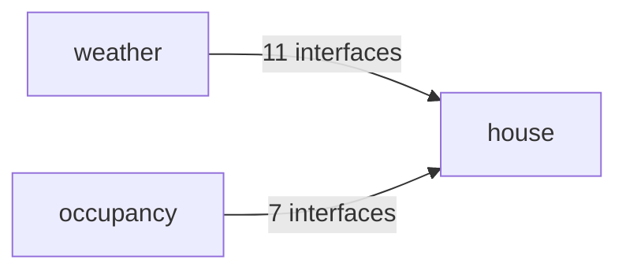

# Quick start

The building example couples three FMI 2.0 models. The weather and the occupancy feed the house,
which is simulated for 100 steps of 15 minutes each. The results are written as files, so no
database is needed.



You need [uv](https://docs.astral.sh/uv/). It also downloads Python if Python 3.12 or newer is missing.
Everything runs in one terminal, in any shell.

## 1. Get the source

```shell
git clone https://github.com/KIT-IAI-ESA/ecosim.git
cd ecosim/simulation_examples
```

All commands on this page run in `simulation_examples`. The first `uv run` creates the environment, which takes a
moment.

## 2. Check the example

```shell
uv run ecosim check building
```

```text
Checked building: 3 simulators, no problems.
  house      FMI 2.0  building/Modules/house      18 inputs   6 outputs
  occupancy  FMI 2.0  building/Modules/occupancy   0 inputs   7 outputs
  weather    FMI 2.0  building/Modules/weather     0 inputs  11 outputs
```

`ecosim check` reads the config files and the FMUs of the simulation as a run reads them, but starts nothing. Each line
is one model with its folder and the number of its inputs and outputs.

## 3. Run it

```shell
uv run ecosim run building --steps 100
```

```text
Checked building: 3 simulators, no problems.
Run 2026-11-14_17-35-27: 100 steps of 15 min, from 2023-01-01 00:00 to 2023-01-02 01:00 UTC.
Started the server and 3 clients. Logs: building/results/2026-11-14_17-35-27/logs
Finished after 2.5 s. Results: files in building/results/2026-11-14_17-35-27
Read them with: uv run ecosim results building
```

`ecosim run` checks the simulation again, starts the server and a client for each model, and waits until the run is
done. Each run gets a new folder in `building/results`, named after the time it started. A command that `ecosim`
prints for you to copy starts the way you started `ecosim`, with `uv run` in `simulation_examples`.

The server and each client write what they print to a log in the `logs` folder of the run. `logs/house.log` has 16
warnings of the house model at time 0. They come from the model and are expected. `logs/server.log` ends with a
summary of the run: the steps, the simulated period and where the results are.

A longer run also shows a progress line, every 10 seconds in the first minute and less often later. This one is
from a run with `--duration 30d`:

```text
Step 1,574 of 2,880 (54 %), simulated 2023-01-17 09:30, 157 steps/s, about 8.3 s left
```

Add `--debug` to get every message in the logs, also one for each step. Ctrl-C stops the server and every client,
and the last line says how to continue the run, see [Run a simulation](../guides/run-a-simulation.md#stop-and-continue-a-run).

## 4. Look at the results

```shell
uv run ecosim results building
```

```text
Results:     building/results/2026-11-14_17-35-27
Run:         finished, 100 steps of 15 min
Simulated:   2023-01-01 00:00 to 2023-01-02 01:00 UTC
Simulators:  house, occupancy, weather
Columns:     24 outputs, 18 inputs are left out (add --inputs)

Column                                         Minimum          Mean       Maximum
house.T_indoor                                  291.14       293.752       295.001
house.Pe_gen                                         0             0             0
house.Pe_load                                 -485.435      -426.473      -182.925
...
```

It shows the newest run of the simulation, with the smallest, the mean and the largest value of each output.
`uv run ecosim results building --csv results.csv` writes the values to `results.csv`, with a row for each step
and a column for each output. [Read the results](../guides/results.md) shows how to open the file in Excel, MATLAB
or pandas, and how to read the results in Python.

The run folder holds:

| File | Content |
| --- | --- |
| `module_house.jsonl`, `module_occupancy.jsonl`, `module_weather.jsonl` | One line for each step with the outputs of that model and the inputs it got |
| `simulation_state.jsonl` | The states of the run, ending with `{"state": "Finished"}` |
| `server_time_measurement.jsonl` | How long the server took |
| `simulation.json` | A copy of the simulation config of the run |
| `logs/` | `server.log` and a log for each client, `house.log`, `occupancy.log` and `weather.log` |

## 5. Change a parameter of the house

The client config of the house, `building/Modules/house/preferences.ini`, ends with a `[start_values]` section:

```ini
[start_values]
# Remove the # to give the walls a U-value of 0.3 W/(m2.K) instead of the 1.2 in the FMU
# U_wall = 0.3
```

Remove the `#` before `U_wall = 0.3`. Then run the simulation again and look only at the room temperature of the house:

```shell
uv run ecosim run building --steps 100
uv run ecosim results building --interface house.T_indoor
```

```text
Results:     building/results/2026-11-14_17-35-51
Run:         finished, 100 steps of 15 min
Simulated:   2023-01-01 00:00 to 2023-01-02 01:00 UTC
Simulators:  house
Columns:     1 output

Column                 Minimum          Mean       Maximum
house.T_indoor         291.917       293.889       295.161

Add --csv results.csv to write the table to a file.
```

With the better walls the room stays warmer: the mean is 293.889 K instead of 293.752 K. `logs/house.log` of the
run lists the value under `Start values`. The section takes any parameter of the FMU, see
[Start values](../reference/configuration-files.md#start-values). Put the `#` back to use the value of the FMU again.

## 6. Make a simulation from FMUs

`ecosim new` writes a simulation folder from FMU files. From the three FMUs of the example:

```shell
uv run ecosim new my_building building/Modules/house/house.fmu building/Modules/occupancy/occupancy.fmu building/Modules/weather/weather.fmu --steps 100 --start-date 2023-01-01
```

```text
Wrote my_building: 3 simulators, 18 connections, no problems.
100 steps of 15 min, from 2023-01-01 00:00 to 2023-01-02 01:00 UTC.
The step size 15min is the default. Choose another with --step-size.
  house      FMI 2.0  my_building/Modules/house      18 inputs   6 outputs
  occupancy  FMI 2.0  my_building/Modules/occupancy   0 inputs   7 outputs
  weather    FMI 2.0  my_building/Modules/weather     0 inputs  24 outputs
Connections:
  house <- weather, 11 connections
    weatherBus_TDryBul  <-  weatherBus.TDryBul
    ...
  house <- occupancy, 7 connections
    occupancyBus_Qdot_sen_human   <-  occupancyBus.Qdot_sen_human
    ...
After a change, check it with: uv run ecosim check my_building
Run it with: uv run ecosim run my_building
```

It connects each input to the output with the same name, where a dot and an underscore count as the same. That
gives the 18 connections of `building/server/simulation.json`. The 100 steps are now in the new simulation, so the run
needs no `--steps`:

```shell
uv run ecosim run my_building
uv run ecosim results my_building --interface house.T_indoor
```

The mean of `house.T_indoor` is 293.752 K, as in the first run of part 3, and all 100 values are the same to the
last digit. The weather model stores 24 outputs instead of 11, since `ecosim new` keeps every output.
[Your own models](your-own-models.md) explains the options, like `--connect` for an input and an output with
different names.

## 7. When something goes wrong

A mistake ends in one line that says what is wrong, often with the closest name:

```text
ecosim results: error: The results have no column house.T_indor. Did you mean house.T_indoor? (run with --debug for the full traceback)
```

Run the same command with `--debug` to see the full traceback. `ecosim check` lists every problem of a simulation at
once, each with its file. Here the client config of the house says `simulator_name=hous`:

```text
Checked building: 2 simulators, 1 problem.
  occupancy  FMI 2.0  building/Modules/occupancy  0 inputs   7 outputs
  weather    FMI 2.0  building/Modules/weather    0 inputs  11 outputs
Problems:
  building/Modules/house/preferences.ini: simulator_name is 'hous', but building/server/simulation.json has no simulator 'hous'. Did you mean house?
Fix it and run the check again: uv run ecosim check building
```

`ecosim run` runs the same check first and starts nothing if it finds a problem.

## What the example consists of

The simulation folder `building` holds:

| File | Purpose |
| --- | --- |
| `server/preferences.ini` | The server's port and its database settings |
| `server/simulation.json` | The simulators, how their interfaces are connected, the step size and the start date |
| `Modules/<model>/preferences.ini` | Where the client finds the server, and which model it runs |
| `Modules/<model>/*.fmu`, `*.fmc` | The model and its interface description |
| `results/` | A folder for each run of `ecosim run` |
| `Executable/` | Scripts that start the server and the clients by hand, with the results in PostgreSQL |

The [configuration reference](../reference/configuration-files.md) lists every key of these files.

## Next steps

- Start the server and the clients by hand, for example on several machines, see
  [Run a simulation](../guides/run-a-simulation.md#start-the-parts-by-hand).
- Store the results in PostgreSQL/TimescaleDB with `--database-type postgres` and the `[database]` section of
  `server/preferences.ini`, see [Run a simulation](../guides/run-a-simulation.md#the-run-folder).
- Run a simulation in containers with the [Docker guide](../guides/docker.md).
- Run many simulations at once on a cluster with the [HPC guide](../guides/hpc-cluster.md).
- Couple a Python model, like a controller or a pandapower grid, with the [Python client](../guides/python-client.md).
- See every option of `ecosim`, the server and the clients in the [command-line reference](../reference/command-line.md).
