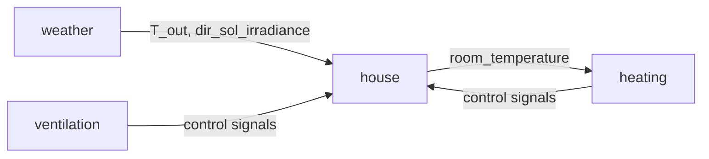

# Docker

This example runs the *house* simulation with one server and four FMI 2.0 clients in containers:



The models come from `ecosim-test-common`: `ecosim_test_common/resources/fmu_v2/models/house/linux`.

There are two variants of the same simulation. They differ only in where the server stores its
results:

| Variant | Results are stored in | Directory |
| --- | --- | --- |
| `postgres` | a TimescaleDB container | `postgres/` |
| `file` | JSON lines on the host, no database needed | `file/` |

All commands below run in `dev/docker/example/`.

## Prerequisites

Build the images once. They are tagged `localhost/ecosim_*`:

```shell
docker compose -f ../compose.yaml build ecosim_server ecosim_client_fmu_v2
```

### How the images are built

- every image comes from `dev/docker/Dockerfile`, with `SOURCE_DIR` and `COMMAND_NAME` as build arguments
- each service in `dev/docker/compose.yaml` sets `image: localhost/<service>:latest`; without it,
  compose tags the build `localhost/docker_<service>` and the examples keep using an older image
- the build turns the package into one self-contained `<command>.pex` and links it to `/opt/ecosim`,
  the `ENTRYPOINT`. The exec form of `ENTRYPOINT` does not expand build arguments, hence the fixed path

## Variant: postgres

```shell
cd postgres
docker compose up --abort-on-container-exit
```

The run takes a few seconds. It is finished when the server prints `SERVER MEASUREMENT` and every
container has exited with code 0. The last block, `SIMULATION FINISHED`, shows the number of steps and
where the results are.

### Check the results

The database container is kept, so the results can be queried after the run:

```shell
docker start ecosim-example-db
docker exec ecosim-example-db psql -U postgres -d sim_control \
  -c "SELECT state FROM ecosim_example.simulation_state;" \
  -c "SELECT * FROM ecosim_example.module_house LIMIT 5;"
```

Expected: state `finished` and one row per simulation step in each `module_*` table.

### Clean up

```shell
docker compose down -v
```

## Variant: file

```shell
cd file
docker compose up --abort-on-container-exit
```

Same run, but without a database service, so nothing has to be started or waited for besides the
server itself.

### Check the results

The server writes into `/results`, which is mounted to `file/results` on the host, so the results
are plain files that can be read without any client:

```shell
ls results
head -n 1 results/module_house.jsonl
cat results/simulation_state.jsonl
```

Expected: one `module_*.jsonl` per simulator, each with one line per simulation step (60 lines for
`--steps=60`), a `server_time_measurement.jsonl` with the runtimes the server prints as
`SERVER MEASUREMENT`, and a `simulation_state.jsonl` that ends with `{"state": "Finished"}`. The folder also
has a copy of the run's `simulation.json`.

Every line is one JSON object. A measurement of the `house` simulator, shortened to one interface:

```json
{"values": [{"name": "room_temperature", "value": 293.1350272259126}], "timestamp": "2024-01-01T00:01:00+00:00"}
```

### Clean up

```shell
docker compose down
rm -rf results
```

With a rootful Docker daemon the files belong to root, so remove them with `sudo rm -rf results`.

## Files

| File | Purpose |
| --- | --- |
| `<variant>/compose.yaml` | the server and the four clients (plus the database in `postgres`) |
| `<variant>/config/server_config.ini` | server port and where the results are stored |
| `<variant>/config/simulation.json` | the simulators and how their interfaces are connected |

`simulation.json` is identical in both variants: what is simulated does not depend on where the
results end up.

## Notes

- The `*_preferences_linux.ini` next to the models point at `localhost:1234`. The clients override
  this with `--server-host=server`, so the shared resources stay untouched.
- The clients retry the connect for 30 seconds, so a plain `depends_on` is enough to start them
  together with the server.
- The executable is the `ENTRYPOINT` of the images, so `command:` only lists arguments, which are
  appended to it. `docker run localhost/ecosim_server:latest --help` works the same way.
- No service publishes a port: the clients reach the server over the compose network. So the variants
  can run at the same time, and next to anything else on the host that uses `1234` or `5432`.
- The FMUs are x86-64 only, so every service sets `platform: linux/amd64` and arm64 hosts run the images under emulation.
- After rebuilding an image, run `docker compose down` before `up`. `up` reuses the existing
  containers and keeps running the old image.
- `docker` may be Podman, where `podman compose` hands over to `podman-compose`. It should not make
  a difference, but check which one runs when something fails.
- The models are mounted from four levels up (`../../../../ecosim-test-common/...`). With a wrong
  path, the container fails on a missing model, not on the mount.

### postgres

- The server writes into the database `sim_control` and the schema `ecosim_example`. It connects to
  the maintenance database `postgres` to create `sim_control` if it is missing.
- `ssl=false` in `server_config.ini` connects with `sslmode=disable`, because TLS is off in the
  container. `ssl=true` connects with `sslmode=require` and fails against a server without TLS.
- `--database-drop-existing-schema` makes the example repeatable. Without it the server aborts when
  the schema of a previous run is still present.

### file

- `type=file` and `directory=/results` in `server_config.ini` select the file based repositories. The
  `[database]` section needs no other key for that. `--database-type=file` and `--database-directory=...` do
  the same on the command line.
- The repositories append to their files, so a second run adds its results to the ones that are
  already there. Delete `results` in between to start clean.
- The server container runs as root, so with a rootful Docker daemon the files in `results` belong
  to root. Rootless Podman maps them to the calling user.
