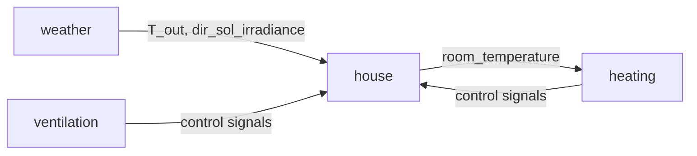

# eCoSim

eCoSim couples independent simulation models into one co-simulation. A **server** owns the clock
and the data flow; one **client** per model advances it step by step.

Models are plugged in through a client for FMI 2.0, FMI 3.0, MATLAB or Pyro5. The server stores the
results in PostgreSQL/TimescaleDB or as JSON lines on disk. For many simulations at once, `ecosim-hpc`
runs server and clients on a Dask cluster.

## How a simulation runs

1. The server reads its config file and the simulation config, which lists the simulators and
   connects their interfaces.
2. The clients connect. The server asks each one for the interfaces of its model and checks them
   against the simulation config.
3. For every step, the server sends each client its inputs and receives its outputs.
4. The server stores the outputs and passes them on to the inputs they are connected to.

The [architecture](development/architecture.md) page describes the messages and the storage in detail.

## Where to go next

- [Development](development/project-setup.md): set up the repository, architecture, tests
